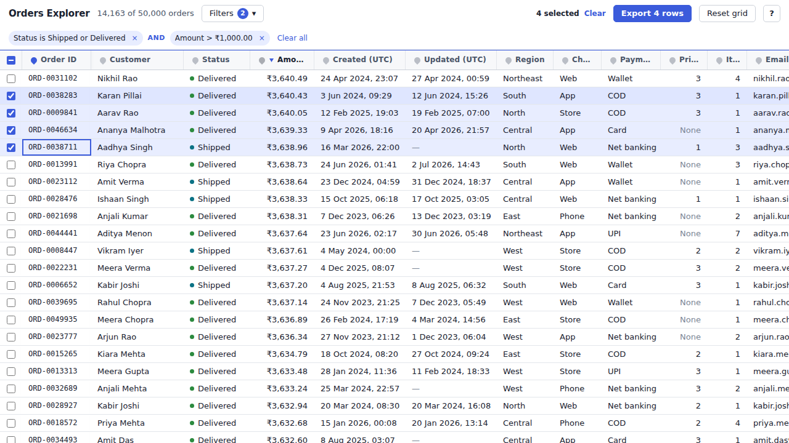
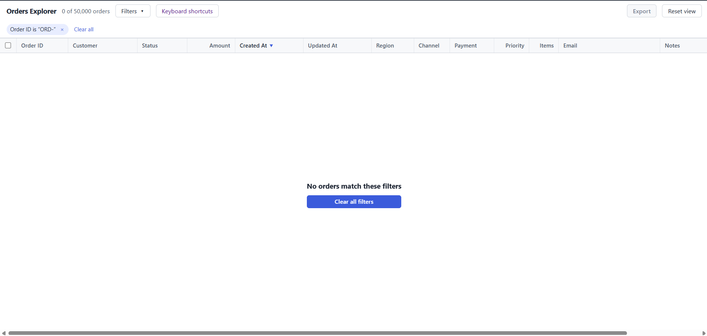

# Orders Explorer

A one-screen tool for looking through 50,000 orders. The data grid shows the orders, and the filter builder decides which ones the grid shows.

I built it for the person in the brief: someone on an operations team, on a 13-inch laptop, working fast and preferring the keyboard to the mouse. So the screen is dense (28px rows, 13px text), the grid gets as much height as possible, and almost everything can be done from the keyboard.

Stack: React, TypeScript, Vite. The grid, the virtualization and the filter builder are all written by me. I did not use any table, grid, virtualization or query-builder library.

## How to run

```bash
npm install
npm run dev        # http://localhost:5173
npm test           # unit tests (data cleaning, sorting, filtering, URL, CSV)
npm run build      # type-check + production build
npm run preview    # serve the production build
```

I used Node 24 as asked (it also runs on Node 22). The keyboard shortcut list is at `/#docs` (for example http://localhost:5173/#docs), and there is a "Keyboard shortcuts" link in the toolbar.

## Screenshots

Main screen with data (a filter, a sort and a few selected rows):



Empty state (the filter matches nothing, with a clear message and a button to clear it):



## What it does

### Data grid

- **Virtualized scrolling.** Only the rows near the screen exist in the DOM (about 30 out of 50,000). Rows are a fixed 28px, so I can work out which rows are visible with simple maths. A few extra rows are kept above and below so fast scrolling never shows gaps.
- **Sorting.** Click a header to sort, click again to reverse. Each column sorts by its real type: dates by time, amounts as numbers, text without caring about case, and status in workflow order (pending to cancelled). Empty values always go last, and ties are broken by order ID so the order never jumps around. The grid opens sorted by **Created At, newest first**, because an operations team looks at recent orders first.
- **Column resize.** Drag the edge of a header. Double-click the edge to reset that column.
- **Pin one column.** Pin a column from its header (or press `P`). It moves to the left edge and stays there when you scroll sideways, like frozen panes in a spreadsheet, with a soft shadow once other columns slide under it. Only one column can be pinned.
- **Selecting rows.** Click a row to select it, Shift+click for a range, Ctrl/Cmd+click to add or remove one row. The toolbar shows how many are selected. The checkbox column and its header checkbox do the same with the mouse.
- **Keyboard.** See the shortcut list below. The focused cell has a clear blue outline.
- **Details.** Press Enter (or use the details panel) to see every field of the focused order. Notes are always shown as plain text, never as HTML, because some notes contain things like `<script>`.
- **Display.** Numbers are right-aligned. Amounts use Indian grouping with two decimals (`₹1,23,456.50`). Every date uses one format, `14 Mar 2025, 09:30`, always in UTC. Long text is cut with an ellipsis, the full value shows on hover, and the notes in full are in the details panel. The header row is sticky.
- **Reset view.** Brings back the default sort (Created At, newest first), default column widths, no pinned column, and scrolls to the top-left. It keeps the filters and the selected orders, because those have their own clear buttons.

### Filter builder

- A condition is a field, an operator and a value. Conditions can be added and removed.
- Inputs match the field type: text (contains, does not contain, equals), numbers (equals, greater than, less than, between), dates (before, after, between, with a date input) and fixed lists (status, region, channel, payment method, priority) where you tick one or more options. Priority has a **None** option for orders with no priority.
- One level of grouping: conditions inside a group are combined with **OR**, groups are combined with **AND**. For example `(status is shipped OR delivered) AND (amount > 1000)`.
- The active filter shows as chips above the grid, with "and" / "or" between them. Each chip can be removed on its own, and there is "Clear all".
- The grid updates as you type, and the toolbar shows the count, for example `1,284 of 50,000 orders`.
- A condition that is not finished (empty value) is **ignored** and its chip is drawn dashed, so adding a new row never changes the results by accident. A range where the minimum is bigger than the maximum, or the start date is after the end date, shows an error and is ignored until fixed.
- Dates are whole UTC days: "between" includes both days, and orders with no Updated At never match a date condition.

### Working together

- **Everything is in the URL:** the filter, the sort, the pinned column and the selected orders. Refresh keeps everything, and a copied link opens the same screen. The default sort (Created At, newest first) is left out of the URL to keep it short; "no sort, original file order" is written as `s=none`.
- **Selected orders are stored compactly** as ranges, so selecting all 50,000 is only about 10 characters.
- **Broken links never crash the app.** If the URL is hand-edited or damaged, each bad part falls back to its default and a notice at the top says what was ignored.
- **Export** downloads the selected orders as a CSV file (see the 200 rows question below).
- **Empty case.** When nothing matches, the grid shows a clear message and a "Clear all filters" button. Selected orders are kept and come back when the filter is cleared.

## Keyboard shortcuts

The same list is on the `/#docs` page.

**Grid**

| Keys | What it does |
| --- | --- |
| Arrow keys | Move focus through rows, columns and headers. Up/Down moves between the header and the body, Left/Right between columns |
| Home / End | First / last column |
| Page Up / Page Down | Move up / down by one page of rows |
| Enter | Open details for the focused row |
| Esc | Close the details panel |

**Selection**

| Keys | What it does |
| --- | --- |
| Space | Select / deselect the focused row |
| Shift + Arrow Up / Down | Extend the selection |
| Ctrl / Cmd + A | Select every row that is shown |
| Delete | Deselect all selected orders (it does not delete any data) |

**Columns** (on the focused column)

| Keys | What it does |
| --- | --- |
| P | Pin / unpin the column |
| S | Sort by the column. Press again to reverse |
| U | Clear the column's sort |

**Filters**

| Keys | What it does |
| --- | --- |
| / | Open Filters and focus the first control |
| Arrow keys | Move between controls and option checkboxes. Select menus and text, number and date inputs keep their normal arrow-key behavior |
| Space | Tick / untick a focused option |
| Ctrl / Cmd + Enter | Add a condition to the focused group (or a group, if focus is outside one) |
| Ctrl / Cmd + Shift + Enter | Add a group |
| Ctrl / Cmd + Backspace | Clear all filters (outside text, number and date inputs) |

New conditions and groups receive focus straight away. To remove one, move to its remove button and press Space or Enter.

**Other**

| Keys | What it does |
| --- | --- |
| Ctrl / Cmd + Z | Undo the last filter, sort, pin, selection or column-width change (outside text, number and date inputs) |
| Alt + R | Reset view |
| Alt + E | Export the selected orders as CSV |

Clicking a row also puts keyboard focus in the grid. When the orders finish loading, the grid takes focus unless you already focused something else, so the Down Arrow works straight away.

## Dependencies

Runtime (only two):

- `react` and `react-dom`: the UI. Everything else (grid, virtualization, filter builder, URL handling, CSV) is my own code.

Dev only: `vite` and `@vitejs/plugin-react` (build and dev server), `typescript` and the `@types/*` packages, and `vitest` (tests).

I did not add a router (the `/#docs` page is chosen in `src/main.tsx` by looking at the URL hash), a state library, a date library or a CSS library. The app is small enough that they would only add weight.

## Data loading

- `orders.json` stays untouched in `public/` and is **fetched when the app starts**. I did not `import` it, because that would put 17 MB into the JavaScript bundle and slow down the first load.
- Parsing and cleaning happen in a **Web Worker**, so the page never freezes while 50,000 records are processed (about one second). The user sees a short "Downloading / Preparing" message and an error with a "Try again" button if loading fails.
- All the messy-data rules from `data-notes.md` are fixed in **one place**, `src/data/normalize.ts`, before the data reaches the grid or the filter, as the notes ask. That includes:
  - both name fields become one Customer, and the amount is turned into rupees (version 1 is paise, version 2 is rupees), also when the amount is a string
  - all four date formats are read as UTC and kept as real timestamps (so sorting and date filters use the real time, not the text)
  - empty / missing `updatedAt`, status and region casing, priority missing shown as None, currency spaces trimmed
  - duplicate order IDs: I keep one record using the rules in the notes (later `updatedAt`, else the one that has it, else the later one in the file). 50,030 records become 50,000 orders.
- Things I noticed beyond the notes, and handled:
  - version 1 amounts given as text are paise too, so they must be converted after being read as numbers
  - dates written as `DD/MM/YYYY` have no time, so the details panel says "time not recorded" and the CSV exports only the date
  - the biggest order is ₹3,640, so the brief's example `amount greater than 5000` correctly matches nothing (a handy way to see the empty state)

## Speed

- Only about 30 rows are rendered, and rows are memoised, so scrolling and selecting stay light.
- Each sort is cached, so switching back to an earlier sort is instant. The first sort of 50,000 rows takes roughly 0.1 seconds.
- Filtering turns the whole filter into one function that is run once per order. Typing in a filter input updates immediately, while the grid waits about 150 ms after the last keystroke before re-filtering.
- Column resizing only changes one CSS variable, so rows are not re-rendered while dragging.

## The 200 rows question

**My choice: export all 200.** The user selected those 200 rows on purpose, and a filter is only a way of looking at the data. If Export quietly dropped the 180 rows that the filter hides, the user would lose work they did and might not notice. Exporting 20 would also mean the file does not match what they selected.

To keep it honest, the toolbar shows `200 selected (180 hidden by filter)`, and the exported CSV has exactly 200 data rows, so the number on screen always matches the file. Rows come in the same order as the grid's current sort. If the user only wants the visible ones, they can deselect the hidden ones first. Delete deselects everything.

Details of the CSV: one row per selected order, UTF-8 with a byte-order mark (so Excel shows ₹ and accents correctly), fields with commas, quotes or line breaks are quoted properly, and cells that start with `=`, `+`, `-` or `@` get a leading apostrophe so spreadsheets do not run them as formulas. The button is simply called "Export" (or press Alt + E) and is disabled until something is selected.

## Design changes

My sketches are in `design/` (the normal screen with data, and the screen when the filter matches nothing). The final app differs a little:

- **The filter builder is collapsed behind a "Filters" button** (shortcut `/`) instead of always being open. On a 13-inch screen an open builder with a few groups takes a lot of height and leaves room for too few rows. The chips stay visible, so the active filter is never hidden.
- **Details open in a side panel** next to the grid instead of a popup, so you can keep looking at the list.
- **No Currency column.** It is always INR, so the ₹ sign on every amount says the same thing. Currency is still in the details panel and the CSV.
- **Added later:** a Reset view button, the `/#docs` keyboard shortcut page, and many more keyboard shortcuts than I first planned, because the brief says the team prefers the keyboard.

## Known issues

- **Sideways scrolling on a 13-inch screen.** All columns together are about 1,700px wide, so at a 1280px screen the last columns (Email and Notes) are off-screen until you scroll sideways. That is also why pinning a column matters. Shorter default widths for those two columns would help; I did not get to it.
- **Column resizing is mouse-only.** Pin, sort and everything else can be done from the keyboard, but resizing a column cannot.
- **Long URLs for scattered selections.** Selecting thousands of rows that are not next to each other makes a long URL (about 3 characters per row). Rows next to each other, including "select all", stay very short.
- **What is not in the URL:** column widths and which panels are open. The URL is updated without adding browser-history entries, so the Back button does not step through filter changes.
- **UTC only.** All dates are shown in UTC. I chose that so sorting, filters and shared links always agree, but it is not the user's local time.
- **The details panel makes the grid narrower** while it is open, which is tight on small windows.
- **Browsers and tests.** I tested in Chromium only. The unit tests cover the data cleaning, sorting, filtering, URL and CSV logic; the screen itself (scrolling, layout, keyboard) was checked by hand and with scripts in the browser, not with automated UI tests.
- **One sort column at a time.** Sorting by two columns together is not supported.

## How the code is organised

```
src/
  data/      loading, cleaning and types (normalize.ts, the worker, useOrders)
  grid/      the generic DataGrid: virtualization, headers, resize, keyboard
  orders/    the orders-specific parts: columns, sorting, selection, details, CSV export
  filter/    the filter model, compile-to-function, builder, chips, labels
  url/       reading and writing the URL (filter, sort, pin, selection)
  lib/       small helpers: number/date formatting, debounce
  main.tsx   picks the app or the /#docs page; App.tsx holds the page state
public/      orders.json (untouched)
design/      my sketches
docs/        screenshots used in this README
```

The grid knows nothing about orders (it takes columns and rows), and the order-specific code sits in `orders/`. Cleaning the data, filtering and sorting are plain functions with tests, so they do not depend on React.